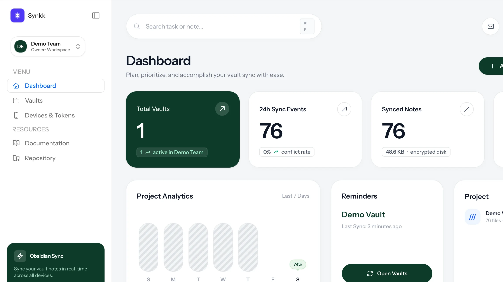
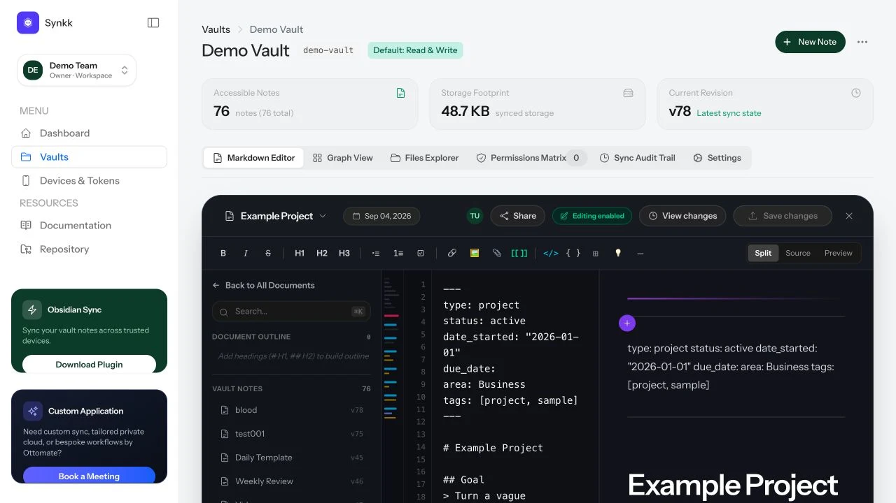
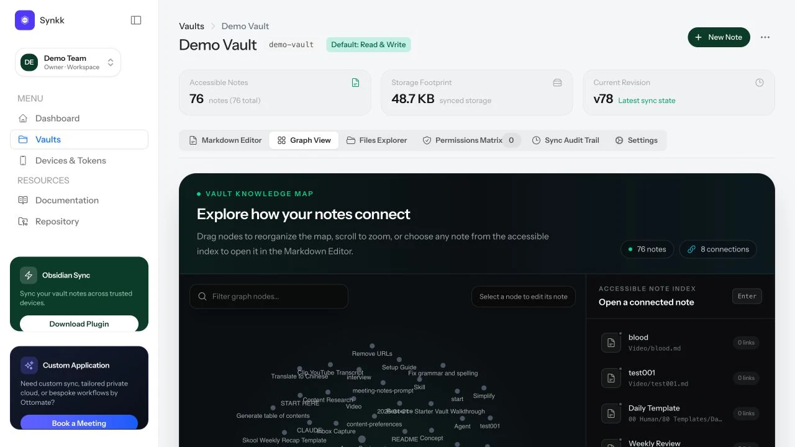
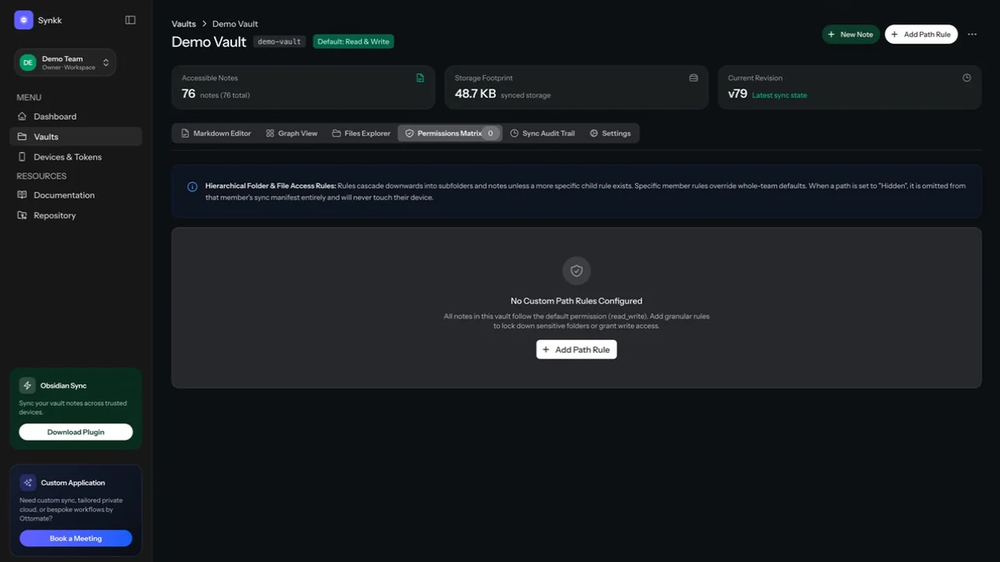

# Synkk

<p align="center">
  
</p>

<p align="center">
  <strong>Sync an Obsidian team vault on infrastructure you control.</strong><br>
  Synkk pairs the Obsidian plugin with a self-hosted server for shared Markdown, version history, and team access.
</p>

<p align="center">
  <a href="https://synkk.space">Website</a> ·
  <a href="https://synkk.space/documentation">Docs</a> ·
  <a href="https://obsidian.md/plugins?id=synkk-sync">Install from Obsidian</a> ·
  <a href="https://github.com/tawandajosephmutsena/synk-obsidian-plugin">Obsidian plugin repo</a> ·
  <a href="https://github.com/tawandajosephmutsena/synkk/discussions">Community discussions</a>
</p>



Synkk is an open-source server and dashboard for teams that want to sync Obsidian without putting their vault on someone else's sync service. Install the Obsidian plugin, run Synkk on your own server, and connect your devices with a pairing code.

**New here?** [See the product screenshots](#product-screens), [install the Obsidian plugin](https://obsidian.md/plugins?id=synkk-sync), then follow the [server setup guide](https://synkk.space/documentation). You can run Synkk on a VPS or try it locally with Docker Compose.

> Synkk is under active development. Features and limits depend on the deployment and team plan. The Community Free plan currently includes one vault, three members, three devices, and 1 GB of storage by default. Some security and team controls require a paid plan. Encrypted vault contents cannot be scanned by the server's plaintext secret scanner.

## Join the community

- [Start a discussion](https://github.com/tawandajosephmutsena/synkk/discussions) to ask questions, share your setup, suggest ideas, or talk with other Synkk users. Reply and react to posts you find useful.
- [Report a bug](https://github.com/tawandajosephmutsena/synkk/issues/new/choose) with steps to reproduce it. Add context or a reaction to an existing issue if you have the same problem.
- [Contribute a fix](CONTRIBUTING.md) by forking this repository and opening a pull request. Reviews and comments on pull requests are welcome.

Please keep credentials, device tokens, private vault content, and vulnerability details out of public posts. See [Security](#security) for private reports.

## Install Synkk

### 🚀 VPS Installer (Ubuntu, Debian, AlmaLinux, Rocky)

Point a public DNS name at your server and allow inbound ports 80 and 443. From a Synkk source checkout, run the installer as root. It prompts for an administrator password or generates one, installs Docker if needed, and starts Synkk behind Caddy HTTPS:

```bash
git clone --recurse-submodules https://github.com/tawandajosephmutsena/synkk.git
cd synkk
sudo SYNKK_DOMAIN=vault.example.com SYNKK_ADMIN_EMAIL=you@example.com bash install.sh
```

Replace the example domain and email. Keep the generated login credentials and `/opt/synkk/.env.production` private. Installation requires a working DNS record and valid TLS certificate; build time depends on your server and network. Configure SMTP after installation to deliver invitations and password recovery emails.

### 🐳 Run With Docker Compose

```bash
# 1. Clone the repository and prepare the environment
git clone --recurse-submodules https://github.com/tawandajosephmutsena/synkk.git
cd synkk
cp .env.production.example .env.production

# 2. Generate a stable APP_KEY and unique Reverb credentials
openssl rand -base64 32
openssl rand -hex 16
openssl rand -hex 32

# 3. Edit .env.production as described below, then start Synkk
docker compose -f docker-compose.prod.yml up -d --build
docker compose -f docker-compose.prod.yml ps
```

In `.env.production`, set `APP_KEY=base64:<output of the first command>`, put the two hex values in `REVERB_APP_KEY` and `REVERB_APP_SECRET`, and set `APP_URL` to your public HTTPS address. Keep `REVERB_HOST=127.0.0.1`, `REVERB_PORT=8080`, and `REVERB_SCHEME=http` for server-side publishing inside the container. Uncomment `SYNKK_BOOTSTRAP_EMAIL` and `SYNKK_BOOTSTRAP_PASSWORD` and replace their examples with your own credentials **before first start**. The container creates that owner account once; sign in at `APP_URL` with those credentials. The database and uploaded files use named Docker volumes and survive container replacement.

This Compose file serves HTTP on host loopback port 8000. Put a trusted HTTPS reverse proxy in front of it, forwarding WebSocket upgrades to the same port, before exposing Synkk publicly. For a localhost-only trial, set `APP_URL=http://localhost:8000` and `SESSION_SECURE_COOKIE=false` in `.env.production`. Configure SMTP before using invitations, password recovery, or email changes; the default log mailer cannot deliver email. After the first login, remove the bootstrap credentials from `.env.production` and recreate the container with `docker compose -f docker-compose.prod.yml up -d`.

## Product Screens

| Dashboard | Markdown Editor |
| --- | --- |
|  |  |

| Graph View | Permissions Matrix |
| --- | --- |
|  |  |

## What you can do with Synkk

- **Self-hosted sync:** Keep the server, database, and vault files on infrastructure you manage.
- **Obsidian plugin:** Sync from desktop and mobile with manual, startup, and scheduled sync, plus QR and deep-link pairing.
- **Conflict and version recovery:** Preserve file history, detect concurrent edits, and restore earlier versions.
- **Team workspace:** Manage members, devices, and vault access from the web dashboard. The free and paid plans have different limits and controls.
- **First-sync checks:** Review a vault's files and storage before its first upload, with safeguards for risky changes.
- **Web access:** Browse and edit Markdown, explore linked notes in a graph, and optionally publish a vault portal.
- **Optional security controls:** Paid plans include path permissions, device restrictions, remote revocation, and plaintext secret scanning. Client-side encryption is available for supported workflows; the server cannot inspect encrypted content.

## Launch Links

- Public app: [synkk.space](https://synkk.space)
- Live Docs Portal: [synkk.space/p/synkk-docs](https://synkk.space/p/synkk-docs)
- Documentation: [synkk.space/documentation](https://synkk.space/documentation)
- Web/server repo: [github.com/tawandajosephmutsena/synkk](https://github.com/tawandajosephmutsena/synkk)
- Obsidian plugin repo: [github.com/tawandajosephmutsena/synk-obsidian-plugin](https://github.com/tawandajosephmutsena/synk-obsidian-plugin)
- Plugin release: [Latest release](https://github.com/tawandajosephmutsena/synk-obsidian-plugin/releases/latest)
- Plan and feature details: [Synkk documentation](https://synkk.space/documentation)

## Install The Plugin

Build the plugin from `obsidian-plugin/`:

```bash
cd obsidian-plugin
npm ci
npm run check
```

Install from Obsidian's Community Plugins browser, or install `main.js`, `manifest.json`, and `styles.css` in `<vault>/.obsidian/plugins/synkk-sync/`. Configure your Synkk API endpoint ending in `/api/v1` and pair the device from the dashboard. For networked servers, use HTTPS.

## Run The Server Locally

```bash
composer setup
composer run dev
```

For production, provide a unique `APP_KEY`, set `APP_ENV=production`, turn `APP_DEBUG=false`, run migrations, configure durable storage and database backups, serve HTTPS, and keep the required workers running. Never commit a populated `.env` file.

## Help the project grow

- [Share feedback or ask a question](https://github.com/tawandajosephmutsena/synkk/discussions).
- [Report a reproducible problem](https://github.com/tawandajosephmutsena/synkk/issues/new/choose).
- [Contribute code or improve the docs](CONTRIBUTING.md). The Obsidian plugin has its own [contribution repository](https://github.com/tawandajosephmutsena/synk-obsidian-plugin).
- If Synkk is useful to you, star this repository so you can find it again and others can discover it.

## Creators

Synkk is created by [Ottomate](https://ottomate.space). Product direction and engineering are led by [Tawanda Joseph Mutsena](https://github.com/tawandajosephmutsena).

## Security

Do not include credentials, device tokens, or vault content in public issues. Until a dedicated security reporting address is published, report suspected vulnerabilities privately through GitHub's private reporting channel when available.

## License

Synkk is released under the [MIT License](LICENSE).
